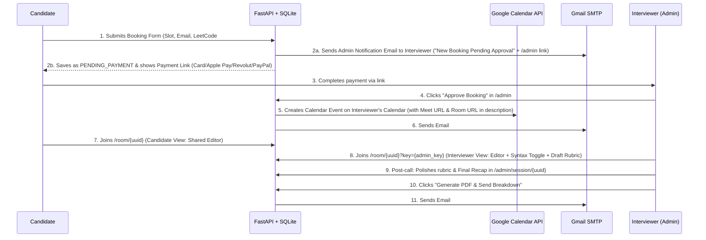

# SWE Mock Interview Platform — Technical Specification & Agent Blueprint

## 1. Project Overview
A lightweight, linear, self-hosted web application for running 1-on-1 Software Engineering Mock Interviews (DSA & future AI-Assisted Multi-File interviews).

### Core Goals
1. **Frictionless Booking & Intake:** Candidates pick an available date/time slot, upload/link their resume, and answer targeted prep questions without creating an account.
2. **Semi-Automated 0%-Fee Payment Flow:** Bookings reserve a slot as `PENDING_PAYMENT` and direct the candidate to pay via a universal payment link (e.g., Revolut.me / Revolut Pro link supporting Apple Pay, Google Pay, and any Credit/Debit card, plus optional PayPal).
3. **1-Click Admin Approval & Cross-Platform Calendar Invite:** Approving a booking in the Admin Dashboard automatically creates a Google Calendar event (generating a free 1-on-1 Google Meet link) and sends **Email #1 (Thread Starter)** with a universal `.ics` calendar file and the unique **Interview Room URL**.
4. **Google-Style Shared Interview Room:** A standalone real-time collaborative coding session where the interviewer can remotely toggle syntax highlighting (`Plain Text` vs. language-specific highlighting) and take private structured notes during the call.
5. **Post-Interview Breakdown PDF (Same Email Thread):** After the call, the interviewer finalizes the evaluation rubric, selects a final hiring verdict (`Strong Hire` to `No Hire`), writes a comprehensive **"Final Recap & Where to Push Preparation to Pass"**, and clicks a button to generate a PDF and send it as **Email #2** inside the **exact same email thread** as the initial invitation.
6. **Future-Proofed for v2 (AI-Assisted Multi-File Interviews):** Workspace state is stored as a multi-file JSON dictionary (`workspace_files`) and includes schema hooks for an integrated AI Chatbot with live prompt mirroring for the interviewer.

---

## 2. Tech Stack & Dependencies

* **Backend Framework:** Python 3.11+ with **FastAPI** + **Uvicorn** (handles HTTP routes, REST APIs, and native WebSockets in a single process).
* **Database:** **SQLite** (via `SQLAlchemy` or `SQLModel` / `sqlite3`) storing all state in a single local `interviews.db` file.
* **Frontend:** Server-rendered **Jinja2** HTML templates + **Tailwind CSS (CDN)** + **Alpine.js (CDN)** for lightweight reactivity + **Ace Editor (CDN)** for the collaborative code editor. Zero Node.js/npm build step required.
* **Calendar & Meet Integration:** `google-api-python-client` + `google-auth-oauthlib` (OAuth2 Refresh Token tied to interviewer's personal Gmail account to generate free Google Meet links) + `icalendar` (for universal `.ics` generation).
* **Email & Threading:** Python built-in `smtplib` + `email.message.EmailMessage` via Gmail SMTP App Password (using deterministic `Message-ID`, `In-Reply-To`, and `References` headers).
* **PDF Generation:** `fpdf2` or `reportlab` (pure Python, zero external OS binaries required) to generate the styled *"Your Interview Breakdown"* PDF.

---

## 3. System Architecture & End-to-End Workflow



---

## 4. Database Schema (`app/database.py`)

### Table 1: `availability_slots`
Manages the interviewer's open time slots.
* `id`: Integer (Primary Key)
* `start_time`: DateTime (UTC ISO-8601)
* `end_time`: DateTime (UTC ISO-8601)
* `is_booked`: Boolean (default `False`)

### Table 2: `interview_sessions`
Core table storing candidate intake, session links, workspace files, email thread identifiers, and rubric notes.
* `id`: String (UUIDv4, Primary Key — used in `/room/{id}`)
* `interviewer_secret`: String (UUIDv4 token or validated via global `ADMIN_SECRET`)
* `slot_id`: Integer (Foreign Key -> `availability_slots.id`)
* `status`: Enum/String (`PENDING_PAYMENT`, `CONFIRMED`, `COMPLETED`, `CANCELLED`)
* `created_at`: DateTime

#### Candidate Intake Fields
* `candidate_name`: String (Required)
* `candidate_email`: String (Required)
* `leetcode_solved`: Integer (Number of LeetCode problems solved)
* `target_company`: String (e.g., "Google, Meta, Spotify")
* `preferred_language`: String (`python`, `cpp`, `java`, `javascript`, `go`, `csharp`, `rust`)
* `target_role`: String (e.g., "Intern", "New Grad / L3", "Mid-Level / L4", "Senior / L5+")
* `resume_path_or_url`: String (Local file path in `uploads/resumes/` or external URL)

#### Meeting & Email Threading Fields
* `google_event_id`: String (Nullable)
* `google_meet_url`: String (Nullable)
* `email_message_id`: String (e.g., `<interview-{id}@gmail.com>` — stored when Email #1 is sent)
* `email_subject`: String (e.g., `Mock Interview Session — {candidate_name} ({date})`)

#### Live Editor & Future v2 Workspace Fields
* `interview_mode`: String (`classic_dsa` by default; `ai_multifile` reserved for v2)
* `syntax_highlighting_enabled`: Boolean (Default `False` — controlled by interviewer toggle)
* `editor_language`: String (Default matches `preferred_language`, e.g., `python`)
* `workspace_files`: JSON (Default: `{"solution.txt": {"content": "# Write your solution here\n", "language": "python"}}`)
* `active_filename`: String (Default: `"solution.txt"`)
* `ai_chat_logs`: JSON (Default: `[]` — reserved for v2 AI-assisted mode)

#### Interviewer Breakdown Rubric & Notes (Saved as Draft until finalized)
* `notes_clarification`: Text (Section 1: Problem Clarification & Requirements)
* `score_clarification`: Integer (1–5 scale, Nullable)
* `notes_approach_complexity`: Text (Section 2: Algorithmic Approach & Time/Space Complexity)
* `score_approach_complexity`: Integer (1–5 scale, Nullable)
* `notes_code_quality`: Text (Section 3: Code Quality, Syntax & Implementation Speed)
* `score_code_quality`: Integer (1–5 scale, Nullable)
* `notes_verification`: Text (Section 4: Verification, Dry-Run & Edge Cases)
* `score_verification`: Integer (1–5 scale, Nullable)
* `final_verdict`: String (Enum: `Strong Hire`, `Hire`, `Lean Hire`, `Lean No Hire`, `No Hire`)
* `final_recap_and_next_steps`: Text (Section 5: Non-judgmental synthesis & concrete action plan based on sections 1–4 on where to push preparation to pass)
* `breakdown_sent_at`: DateTime (Nullable)

---

## 5. Detailed Feature Specifications

### Feature 1: Candidate Booking & Intake (`/`)
1. **Slot Picker:** Displays available dates and times (automatically converted to the candidate's local browser timezone via `Intl.DateTimeFormat`).
2. **Candidate Intake Form:**
   * Full Name & Email Address
   * **LeetCode Problems Solved** (Number input, e.g., `180`)
   * **Target Company / Companies** (Text input, e.g., `Google, Amazon`)
   * **Target Role / Level** (Dropdown: `Internship`, `Junior / New Grad (L3)`, `Mid-Level (L4)`, `Senior (L5+)`)
   * **Preferred Coding Language** (Dropdown: `Python`, `C++`, `Java`, `JavaScript / TypeScript`, `Go`)
   * **Resume** (File upload `.pdf` up to 5MB, or URL input)
3. **Payment Redirection & Instant Admin Notification (`/booking/{id}/payment`):**
   * Marks the selected slot as temporarily reserved (`PENDING_PAYMENT`).
   * **Sends an Instant Admin Notification Email to the Interviewer (`ADMIN_EMAIL`):**
     * Subject: `[Action Required] New Mock Interview Booking — {candidate_name} ({slot_time})`
     * Body: Candidate's email, requested slot, LeetCode count, target company, role, preferred language, and a direct 1-click link to `/admin` to approve once payment arrives.
   * Displays the payment instructions and direct payment buttons to the candidate:
     * **Primary (Card / Apple Pay / Google Pay):** Revolut Payment Link (`revolut.me/...` or Revolut Pro link—no app required for payer).
     * **Secondary:** PayPal.me link.

### Feature 2: Comprehensive Admin Panel (`/admin`)
Protected by HTTP Basic Auth or a session cookie using `ADMIN_PASSWORD` from `.env`. The Admin Panel is organized into four distinct tabs/views so the interviewer can manage the entire lifecycle of every interview:

1. **Pending Bookings Queue (`status == "PENDING_PAYMENT"`):**
   * Shows candidate details (Name, Email, Requested Date/Time, LeetCode count, Target Company, Role, Language, Resume link).
   * **"Approve & Send Invite" Button:**
     1. Calls `calendar_meet.create_google_meet_event()` to create an event on the interviewer's Google Calendar (`sendUpdates="all"`), embedding both the auto-generated `hangoutLink` (`meet.google.com/...`) and the **Interview Room URL (`{BASE_URL}/room/{id}`)** inside the Calendar Event description. Because the event is created on the interviewer's own calendar, it automatically appears on the interviewer's calendar and sends Google's native calendar notification.
     2. Generates an RFC-5545 compliant `.ics` file containing the event, Google Meet URL, and Interview Room URL (`{BASE_URL}/room/{id}`).
     3. Sends **Email #1 (Thread Starter)** via Gmail SMTP (and CC's/stores in Interviewer's Sent folder) with:
        * Custom header `Message-ID: <interview-{id}@{SMTP_DOMAIN}>`
        * `Subject: Mock Interview Session - {candidate_name}`
        * Body containing the Date/Time, Google Meet Link, Standalone Interview Room Link, and preparation tips.
        * Attached `invite.ics` (`text/calendar; method=REQUEST`) for non-Google Calendar clients.
     4. Updates `status = "CONFIRMED"` and saves `email_message_id` and `email_subject` so the post-interview Breakdown PDF (Email #2) can reply directly to this thread.

2. **Upcoming Interviews (`status == "CONFIRMED"` & `start_time >= now`):**
   * Chronological list of all scheduled upcoming sessions.
   * Displays candidate intake summary badges (LeetCode solved, Target Company, Target Role, Preferred Language, Resume button).
   * Quick-action buttons for interview day:
     * **"Open Interviewer Room"** (`/room/{id}?key={ADMIN_SECRET}`)
     * **"Join Google Meet"** (`google_meet_url`)
     * **"Copy Candidate Room Link"** (`/room/{id}`)
     * **"Mark as Completed / Go to Breakdown"**

3. **Past Interviews & Judgement Archive (`start_time < now` or `status == "COMPLETED"`):**
   * Permanent historical log of every conducted interview session.
   * Displays for each session:
     * Candidate Name, Email, Date, Target Company & Role.
     * **Stored Judgement Badge:** Color-coded badge showing the saved `final_verdict` (`Strong Hire`, `Hire`, `Lean Hire`, `Lean No Hire`, `No Hire`, or `Pending Judgement` if not yet graded).
     * **Breakdown Delivery Status:** Indicates whether notes are still in `Draft` or if the `Breakdown PDF Sent` (with timestamp).
   * **Actions per Past Session:**
     * **"Edit Judgement & Breakdown Notes"** (`/admin/session/{id}`): Open the full evaluation form to store/update the judgement, scores (1–5), detailed section notes, and the Final Recap at any time.
     * **"View Code Snapshot"**: Inspect the final code written during that session.
     * **"Preview / Download PDF"** & **"Send Breakdown Email"**: Generate the PDF report or send/resend it into the candidate's original email thread.

4. **Slot Management:**
   * Add single or recurring weekly availability time slots and delete unbooked slots.

### Feature 3: Standalone Live Interview Room (`/room/{id}`)
Synchronized in real time via FastAPI WebSocket endpoint `/ws/room/{id}`.

#### Candidate View (`/room/{id}`)
* **Top Bar:** Session status indicator, current mode (`Plain Text` vs `Syntax Highlighted: Python`), and a **"Join Google Meet"** button.
* **Main Area:** Full-height **Ace Editor** instance:
  * Autocomplete, live linting, and code folding are **disabled** to mirror a true Google interview environment.
  * When `syntax_highlighting_enabled == False`, Ace Editor mode is locked to `ace/mode/text`.
  * When `syntax_highlighting_enabled == True`, Ace Editor mode dynamically switches to `ace/mode/{editor_language}`.
* **WebSocket Sync:** Debounced text updates (~100ms) broadcast changes between Candidate and Interviewer and persist to SQLite every few seconds.

#### Interviewer View (`/room/{id}?key={ADMIN_SECRET}`)
Split-screen layout (55% Editor / 45% Interviewer Control & Rubric Panel):
* **Left Pane (Shared Editor + Controls):**
  * **Syntax Highlighting Toggle Switch:** Turning it `ON` or changing the language dropdown immediately broadcasts a `config_update` WebSocket event that toggles syntax highlighting on both the interviewer's and candidate's screens.
  * *(v2 Hook)* **Mode Toggle:** Switch between `Classic Single-File` and `Multi-File + AI Assistant`.
* **Right Pane (Private to Interviewer):**
  * **Candidate Context Card:** Compact badge view showing: *LeetCode Solved*, *Target Company*, *Target Role*, *Preferred Language*, and a 1-click *View Resume* link.
  * **Live Rubric & Notes Form (Auto-Saving Draft):**
    * **1. Problem Clarification:** Score (1–5) + Notes textarea.
    * **2. Algorithmic Approach & Complexity:** Score (1–5) + Notes textarea.
    * **3. Code Quality & Syntax:** Score (1–5) + Notes textarea.
    * **4. Verification & Edge Cases:** Score (1–5) + Notes textarea.
    * **Final Result Selector:** `Strong Hire` | `Hire` | `Lean Hire` | `Lean No Hire` | `No Hire`.
    * **5. Final Recap & Where to Push Preparation to Pass:** Dedicated synthesis textarea for actionable study advice based on points 1–4.
  * **"Save Draft" & "Open in Post-Interview Editor" Buttons:** Saves all notes without sending anything to the candidate until the interviewer is ready.

### Feature 4: Post-Interview Breakdown Finalization & Same-Thread PDF Delivery (`/admin/session/{id}`)
1. After the interview ends, the interviewer opens `/admin/session/{id}` to review the code snapshot, polish sections 1–4, refine the **Final Recap & Where to Push Preparation to Pass**, and confirm the **Final Result**.
2. **"Preview PDF" Button:** Opens the generated PDF in a new browser tab to verify formatting before sending.
3. **PDF Structure (`app/services/pdf_report.py`):**
   * **Header:** *"Your Mock Interview Breakdown"*, Candidate Name, Date, Target Role/Company, and a prominent badge for the **Final Result** (`Strong Hire` / `Lean Hire` / `No Hire`, etc.).
   * **Section 1–4 Breakdown Table:** Structured scores and detailed interviewer observations for Clarification, Approach & Complexity, Code Quality, and Verification.
   * **Section 5 — Final Recap & Action Plan (Where to Push Your Prep):** Highlighted callout box summarizing key takeaways and concrete next steps to pass the real interview.
   * **Appendix — Code Snapshot:** Clean monospace rendering of the final code written during the session.
4. **"Send Breakdown in Email Thread" Button:**
   * Sends **Email #2** via Gmail SMTP with the PDF attached (`Interview_Breakdown_{Candidate_Name}.pdf`) and these exact headers:
     * `To: {candidate_email}`
     * `Subject: Re: {session.email_subject}`
     * `In-Reply-To: {session.email_message_id}`
     * `References: {session.email_message_id}`
   * Marks session status as `COMPLETED` and logs `breakdown_sent_at`.

---

## 6. Project Directory Structure

```text
swe-mock-platform/
├── .env.example                 # Environment variables template (SMTP, Google OAuth, Admin Key, Payment Links)
├── requirements.txt             # Python dependencies
├── README.md                    # Setup instructions (Google OAuth token generation & running locally)
├── uploads/
│   └── resumes/                 # Stored candidate PDF resumes
├── app/
│   ├── __init__.py
│   ├── main.py                  # FastAPI entrypoint, HTTP routes, and WebSocket room broadcaster
│   ├── config.py                # Settings loader from .env
│   ├── database.py              # SQLite connection & table initialization
│   ├── models.py                # Pydantic / SQLite data models
│   ├── services/
│   │   ├── calendar_meet.py     # Google Calendar OAuth2 client (Meet link creator) + .ics file builder
│   │   ├── email_service.py     # Threaded SMTP sender (Email #1 Invite & Email #2 Reply with PDF)
│   │   ├── pdf_generator.py     # FPDF2 builder for the "Your Interview Breakdown" document
│   │   └── ai_assistant.py      # Stub/interface ready for v2 multi-file LLM chat integration
│   └── templates/
│       ├── base.html            # Shared layout (Tailwind CSS + Alpine.js CDN)
│       ├── book.html            # Public landing & slot booking + candidate intake form
│       ├── payment.html         # Post-booking payment screen (Revolut/Card/PayPal links)
│       ├── room.html            # Shared Ace Editor + Interviewer private rubric sidebar
│       ├── admin_dashboard.html # Slot manager & booking approval queue
│       └── admin_breakdown.html # Post-interview note polisher, PDF previewer, and email sender
└── scripts/
    └── setup_google_oauth.py    # One-time CLI helper to generate Google Calendar token.json
```

---

## 7. Step-by-Step Implementation Plan for the Agent

1. **Step 1 — Scaffold & Database (`app/database.py`, `app/models.py`, `app/config.py`):**
   * Set up the SQLite database schema (`availability_slots` and `interview_sessions`) and `.env` configuration loader.
2. **Step 2 — Booking Flow & Admin Dashboard (`app/main.py`, `book.html`, `payment.html`, `admin_dashboard.html`):**
   * Build the slot management UI for the interviewer, the public booking + intake form (including resume upload), and the semi-automated payment screen.
3. **Step 3 — Google Meet, `.ics`, & Threaded Email Service (`calendar_meet.py`, `email_service.py`):**
   * Implement the `.ics` generator and Gmail SMTP sender with custom `Message-ID` tracking and `In-Reply-To`/`References` threading. Include a fallback mode so the app works locally even before Google OAuth credentials are configured.
4. **Step 4 — Real-Time Interview Room (`room.html`, WebSocket handler in `app/main.py`):**
   * Build the WebSocket room manager supporting real-time code synchronization, the interviewer's remote syntax-highlighting toggle, the candidate intake summary card, and auto-saving draft rubric notes.
5. **Step 5 — Post-Interview Breakdown Editor & PDF Generator (`pdf_generator.py`, `admin_breakdown.html`):**
   * Build the PDF generator with all 5 sections + Final Verdict + Code Snapshot, the PDF preview endpoint, and the 1-click threaded email sender.
