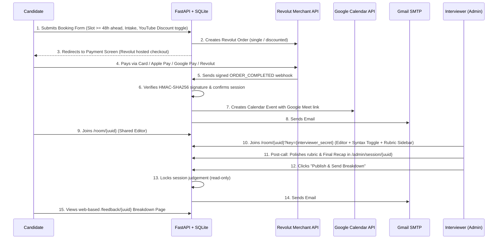

# SWE Mock Interview Platform — Technical Specification & Architecture

## 1. Project Overview
A lightweight, linear, self-hosted web application for running 1-on-1 Software Engineering Mock Interviews (DSA & future AI-Assisted Multi-File interviews), automated payments via Revolut Merchant API, instant calendar booking, real-time shared coding rooms, and structured candidate feedback reports.

### Core Goals
1. **Frictionless Booking & Intake:** Candidates pick an available date/time slot (filtered by a minimum 48-hour advance window), upload/link their resume, and answer targeted prep questions without creating an account.
2. **Automated Revolut Merchant API Payments & Webhook Confirmation:** Bookings create a Revolut Merchant Order. Upon payment completion, a cryptographically verified webhook (`ORDER_COMPLETED`) automatically confirms the booking, creates the Google Calendar event, sends the calendar invitation email with `.ics`, and frees expired holds.
3. **Flexible Single & 3-Session Bundles:** Support for single sessions (€70 standard / €52 with 25% YouTube discount) and 3-session bundles (€190 standard / €142 with 25% YouTube discount). Bundle tokens are derived using HMAC-SHA256, allowing candidates to book their sessions across time via `/bundle/b/{token}` or retrieve them via `/bundle/lookup`.
4. **Google-Style Shared Interview Room:** A standalone real-time collaborative coding session where the interviewer can remotely toggle syntax highlighting (`Plain Text` vs. language-specific highlighting), view candidate intake info, and take private structured notes during the call. Authenticated via per-session `interviewer_secret` tokens or admin cookies.
5. **Web-Based Feedback Breakdown Page (Same Email Thread):** After the call, the interviewer finalizes the evaluation rubric, selects a final hiring verdict (`Strong Hire` to `No Hire`), writes a comprehensive **"Final Recap & Where to Push Preparation to Pass"**, and clicks **"Publish & Send Breakdown"**. This locks the judgement, makes `/feedback/{id}` accessible to the candidate with noindex/no-store headers, and sends **Email #2** inside the **exact same email thread** as the initial invitation.
6. **Future-Proofed for v2 (AI-Assisted Multi-File Interviews):** Workspace state is stored as a multi-file JSON dictionary (`workspace_files`) and includes schema hooks for an integrated AI Chatbot with live prompt mirroring for the interviewer.

---

## 2. Tech Stack & Dependencies

* **Backend Framework:** Python 3.11+ with **FastAPI** + **Uvicorn** (handles HTTP routes, REST APIs, and native WebSockets in a single process).
* **Database:** **SQLite** with WAL mode (`PRAGMA journal_mode = WAL;`) and optimized indexes for fast queries, schema-initialization caching, and transactional safety.
* **Frontend:** Server-rendered **Jinja2** HTML templates + **Tailwind CSS (CDN)** + **Alpine.js (CDN)** for lightweight reactivity + **Ace Editor (CDN)** for the collaborative code editor. Zero Node.js/npm build step required.
* **Calendar & Meet Integration:** `google-api-python-client` + `google-auth-oauthlib` (OAuth2 Refresh Token tied to interviewer's personal Gmail account to generate free Google Meet links) + `icalendar` (for universal `.ics` generation).
* **Email & Threading:** Python built-in `smtplib` + `email.message.EmailMessage` via Gmail SMTP App Password (using deterministic `Message-ID`, `In-Reply-To`, and `References` headers).
* **Payments:** Revolut Merchant API v1 (`/api/orders`) + Webhooks signed with HMAC-SHA256 (`revolut-signature`).
* **Security & Hardening:**
  * Startup guard refusing default passwords/secrets in production (`APP_ENV`).
  * Double-submit CSRF cookie middleware (`swe_mock_csrf`) on all state-changing `POST` endpoints.
  * In-memory sliding-window rate limiters for checkout, login, booking, and webhooks with automated periodic pruning.
  * Trusted reverse-proxy IP resolution (`TRUSTED_PROXIES`).
  * Strict security headers (`Strict-Transport-Security`, `Permissions-Policy`, `Referrer-Policy`, `X-Robots-Tag: noindex, nofollow`, `Cache-Control: no-store`).

---

## 3. System Architecture & End-to-End Workflow



---

## 4. Database Schema (`app/database.py`)

### Table 1: `availability_slots`
Manages the interviewer's open time slots.
* `id`: Integer (Primary Key)
* `start_time`: DateTime (UTC ISO-8601)
* `end_time`: DateTime (UTC ISO-8601)
* `is_booked`: Boolean (default `0`)

### Table 2: `bundles`
Manages 3-session packages and HMAC-derived access tokens.
* `id`: String (UUIDv4, Primary Key)
* `candidate_name`: String
* `candidate_email`: String (Indexed)
* `token_hash`: String (SHA-256 of derived token)
* `token_nonce`: String (Random salt for HMAC derivation)
* `total_sessions`: Integer (Default 3)
* `used_sessions`: Integer (Default 0)
* `revolut_order_id`: String (Indexed)
* `created_at`: DateTime
* `expires_at`: DateTime

### Table 3: `interview_sessions`
Core table storing candidate intake, session links, workspace files, email thread identifiers, and rubric notes.
* `id`: String (UUIDv4, Primary Key — used in `/room/{id}`)
* `interviewer_secret`: String (UUIDv4 token for interviewer room & rubric access)
* `slot_id`: Integer (Foreign Key -> `availability_slots.id`, Indexed)
* `status`: Enum/String (`PENDING_PAYMENT`, `CONFIRMED`, `COMPLETED`, `CANCELLED`, `RESCHEDULE_REQUESTED`)
* `created_at`: DateTime
* `hold_expires_at`: DateTime (Indexed — 30-minute hold window for pending checkouts)
* `revolut_order_id`: String (Indexed)
* `bundle_id`: String (Nullable, Foreign Key -> `bundles.id`, Indexed)

#### Candidate Intake Fields
* `candidate_name`: String (Required)
* `candidate_email`: String (Required, Indexed)
* `leetcode_solved`: Integer
* `target_company`: String
* `preferred_language`: String (`python`, `cpp`, `java`, `javascript`, `go`, `csharp`, `rust`)
* `target_role`: String
* `resume_path_or_url`: String (Local file path in `uploads/resumes/` or external URL)
* `youtube_discount`: Boolean (Whether candidate opted into 25% discount in exchange for YouTube recording release)

#### Meeting & Email Threading Fields
* `google_event_id`: String (Nullable)
* `google_meet_url`: String (Nullable)
* `email_message_id`: String (e.g., `<interview-{id}@domain>` — stored when Email #1 is sent)
* `email_subject`: String (e.g., `Mock Interview Session — {candidate_name} ({date})`)

#### Live Editor & Future v2 Workspace Fields
* `interview_mode`: String (`classic_dsa` by default; `ai_multifile` reserved for v2)
* `syntax_highlighting_enabled`: Boolean (Default `0` — controlled by interviewer toggle)
* `editor_language`: String (Default matches `preferred_language`, e.g., `python`)
* `workspace_files`: JSON (Default: `{"solution.txt": {"content": "# Write your solution here\n", "language": "python"}}`)
* `active_filename`: String (Default: `"solution.txt"`)
* `ai_chat_logs`: JSON (Default: `[]` — reserved for v2 AI-assisted mode)

#### Interviewer Breakdown Rubric & Notes
* `notes_clarification`: Text
* `score_clarification`: Integer (1–5 scale, Nullable)
* `notes_approach_complexity`: Text
* `score_approach_complexity`: Integer (1–5 scale, Nullable)
* `notes_code_quality`: Text
* `score_code_quality`: Integer (1–5 scale, Nullable)
* `notes_verification`: Text
* `score_verification`: Integer (1–5 scale, Nullable)
* `final_verdict`: String (Enum: `Strong Hire`, `Hire`, `Lean Hire`, `Lean No Hire`, `No Hire`)
* `final_recap_and_next_steps`: Text (Synthesis & concrete action plan)
* `breakdown_sent_at`: DateTime (Nullable — setting this permanently locks the session to read-only)

---

## 5. Detailed Feature Specifications

### Feature 1: Candidate Booking & Intake (`/book`)
1. **Slot Picker:** Displays available dates and times at least 48 hours in the future (`MIN_BOOKING_HOURS_AHEAD=48`), converted to the candidate's local browser timezone via `Intl.DateTimeFormat`.
2. **Pricing & YouTube Discount:** Single session €70, or €52 (25% off) if the candidate checks the YouTube release box.
3. **Intake Form:** Name, Email, LeetCode solved count, Target Company, Target Role, Language, Resume upload/URL.
4. **Temporary Hold:** Creates session with `status = PENDING_PAYMENT` and a 30-minute hold window (`hold_expires_at`). Stale holds are automatically pruned.
5. **Anti-Spam & Honeypot:** Honeypot field `website_url` catches bots. Concurrency limits per IP prevent slot hoarding.

### Feature 2: Revolut Merchant API Integration (`/api/webhooks/revolut`)
1. **Order Creation:** Generates hosted Revolut checkout orders via `POST /api/orders` with amount in cents, currency `EUR`, and webhook callback URLs.
2. **Signature Verification:** Validates `revolut-signature` using HMAC-SHA256 with timestamp tolerance check (prevents replay attacks).
3. **Webhook Auto-Confirmation:** On `ORDER_COMPLETED`, automatically confirms the session, creates Google Calendar event, sends Email #1 with `.ics`, and updates database transactionally.

### Feature 3: 3-Session Bundles (`/bundle/checkout`, `/bundle/b/{token}`)
1. **Purchase Flow:** Candidate selects standard (€190) or YouTube discount (€142) bundle and completes payment.
2. **HMAC-Derived Token:** Bundle access URL uses `/bundle/b/{token}` where the token is derived with HMAC-SHA256 using `BUNDLE_TOKEN_SECRET`. Only token hash and nonce are stored in SQLite.
3. **Self-Service Booking & Lookup:** Candidates can book remaining sessions from their bundle balance or look up their active bundles via email at `/bundle/lookup`.

### Feature 4: Standalone Live Interview Room (`/room/{id}`)
1. **Candidate View:** Clean, distraction-free Ace Editor instance with autocomplete and syntax highlighting initially disabled to mirror real FAANG whiteboard conditions.
2. **Interviewer View:** Accessed via per-session `interviewer_secret` or authenticated admin cookie (`swe_mock_admin_token`). Global `ADMIN_SECRET` is rejected for room entry. Provides remote syntax toggle switch and live draft rubric notes form.
3. **WebSocket Sync (`/ws/room/{id}`):** Debounced bi-directional code synchronization, cursor sync, and language/mode configuration updates.

### Feature 5: Web-Based Feedback Breakdown Page (`/feedback/{id}`)
1. **Candidate Report:** Accessible at `/feedback/{id}` once published. Features structured score breakdowns (Clarification, Approach, Code Quality, Verification), verdict badge, and the detailed Final Recap & Action Plan.
2. **Access Control & Privacy:**
   - Unreleased draft sessions return `404 Not Found` for unauthenticated visitors.
   - Admin session holders can preview the feedback page at any time.
   - Response headers include `X-Robots-Tag: noindex, nofollow` and `Cache-Control: no-store` to prevent search engine indexing and caching.
3. **Judgement Locking:** Once published (`breakdown_sent_at` set), the rubric is permanently locked: the admin editor becomes read-only and API update endpoints reject modifications with `409 Conflict`.
4. **Threaded Email Delivery:** Sends Email #2 via Gmail SMTP with `In-Reply-To` and `References` headers set to Email #1's `Message-ID`, keeping all interview communication within a single candidate thread.

### Feature 6: Admin Dashboard (`/admin`)
1. **Authentication:** Random revocable session cookie (`swe_mock_admin_token`) with configurable TTL and `Secure` attribute.
2. **Upcoming Calls:** Confirmed sessions with Google Meet links, candidate intake summaries, and 1-click room access.
3. **Past Interviews (Paginated):** Historical archive displaying judgements (`Strong Hire` to `No Hire`), delivery status (`Judgement Sent` vs `Draft Notes`), with client-side Alpine.js pagination (10 sessions per page).
4. **Availability Manager:** Side-by-side visual interface with 2-month interactive calendar for single-day overrides and a 7-day recurring weekly template with 60-day auto-sync.

---

## 6. Project Directory Structure

```text
swe-mock-platform/
├── .env.example                 # Environment variables template
├── requirements.txt             # Pinned Python dependencies (pip-audit clean)
├── pytest.ini                   # Pytest configuration
├── SPECIFICATION.md             # Platform technical specification
├── uploads/
│   └── resumes/                 # Uploaded candidate PDF resumes
├── app/
│   ├── __init__.py
│   ├── config.py                # Environment configuration & production startup guards
│   ├── database.py              # SQLite schema, WAL mode, indexes, and queries
│   ├── main.py                  # FastAPI routes, CSRF middleware, rate limits, WebSocket rooms
│   ├── models.py                # Pydantic schemas (rubrics, slots, intake, webhooks)
│   ├── services/
│   │   ├── calendar_meet.py     # Google Calendar OAuth2 client & .ics builder
│   │   ├── email_service.py     # Threaded SMTP mailer with deterministic Message-IDs
│   │   └── ai_assistant.py      # Stub for v2 AI multi-file interview mode
│   └── templates/
│       ├── base.html            # Shared layout (Tailwind CSS, Alpine.js, CSRF token)
│       ├── landing.html         # Homepage with pricing, value proposition, and CTA
│       ├── book.html            # Public slot picker (>=48h) and candidate intake form
│       ├── payment.html         # Revolut payment redirect and status polling
│       ├── bundle_checkout.html # 3-session bundle purchase page
│       ├── bundle_hub.html      # Self-service bundle booking interface
│       ├── room.html            # Real-time shared Ace Editor + private rubric sidebar
│       ├── admin_dashboard.html # Upcoming calls, paginated past archive, visual slot scheduler
│       ├── admin_breakdown.html # Post-call rubric editor, verdict assignment, publish action
│       └── candidate_feedback.html # Web-based feedback report (/feedback/{id})
└── tests/
    ├── conftest.py              # Test fixtures and database isolation
    └── test_platform.py         # Full test suite covering all platform flows
```
